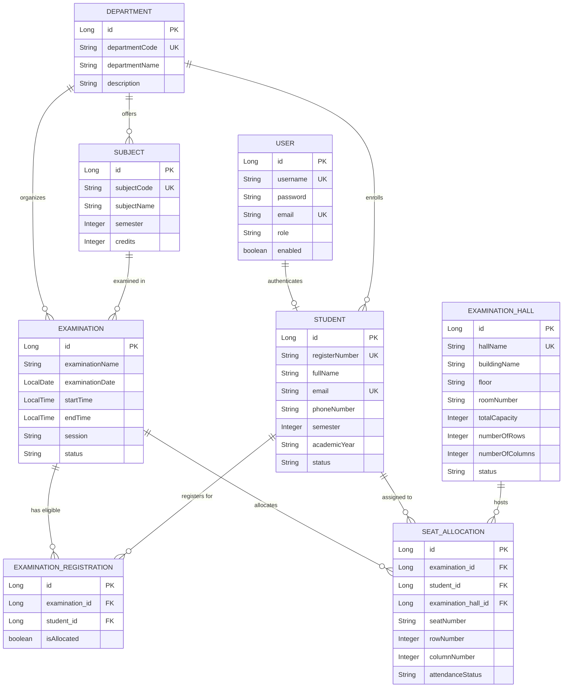

# Smart Exam Hall Seating Arrangement System
**Autonomous Academic Examination Seating & Attendance Automation Suite**

---

## 📌 Project Overview

The **Smart Exam Hall Seating Arrangement System** (**SMART EXAM SEAT**) is a modern, full-stack Java web application designed for colleges and universities to automate the complex process of allocating examination halls, rooms, and physical seat positions to registered students.

Manual examination seating arrangement is labor-intensive, prone to human error, double-booking of seats, candidate allocation conflicts, and capacity oversights. **SMART EXAM SEAT** eliminates these challenges through a deterministic, transactional server-side seat allocation algorithm that strictly respects examination hall capacities, maintains 2D row-column seating matrices, ensures candidate uniqueness, and provides instant printable seating rosters, door charts, and invigilator attendance sheets.

---

## 🚀 Key Features

### 1. Role-Based Access Control (RBAC) & Authentication
- **Spring Security 6** with BCrypt password hashing (`ROLE_ADMIN` and `ROLE_STUDENT`).
- Distinct admin dashboard and secure student self-service portal.
- Protection against unauthorized URL parameter manipulation; student records are retrieved directly from the authenticated session.
- Pre-configured administrator account and automatic student user provisioning upon registration.

### 2. Academic Infrastructure Management (CRUD)
- **Departments**: Management of branches/departments (e.g., CSE, IT, ECE, MECH, CIVIL) with course code validations and safety deletion checks.
- **Subjects**: Course catalog linked to departments, semester levels (1–8), and credit weights.
- **Examination Halls**: Configurable venue matrices with building name, floor, room number, total capacity, rows, columns, and active/inactive toggle.
  - Automatically calculates physical capacity ($Rows \times Columns$) and enforces effective capacity ($\min(TotalCapacity, Rows \times Columns)$).
- **Student Directory**: Student records with register number, full name, email, phone, semester, and academic year. Includes CSV bulk import with automatic account provisioning.

### 3. Examination Scheduling & Candidate Eligibility
- Timetable management specifying subject, department, semester, exam date, start/end time, academic year, and session (Forenoon / Afternoon).
- Validates that start time precedes end time and prevents duplicate schedule overlaps.
- **Candidate Eligibility Registry**: Granular candidate registration per examination. Admin can bulk-register entire classes by department and semester or add individual candidates.

### 4. Automatic Seat Allocation Engine (Core Feature)
- **Deterministic Java Backend Algorithm**:
  1. Retrieves all eligible candidates registered for the target examination.
  2. Retrieves selected active examination halls and computes usable capacities.
  3. Verifies total seat availability. **If seats are insufficient, execution halts immediately with a clear, exact notice**:
     `"Allocation cannot be completed. Eligible students: X. Available seats: Y. Additional seats required: Z."`
  4. Sorts candidates deterministically by Department, Semester, and Register Number (or strictly Register Number).
  5. Traverses halls row-by-row (Row $A, B, C\dots$) and column-by-column ($01, 02, 03\dots$), generating seat numbers such as `A-01`, `A-02`.
  6. Enforces database constraints: no physical seat assigned twice, no student allocated twice.
  7. Wraps allocations in a database transaction (`@Transactional(isolation = Isolation.SERIALIZABLE)`) ensuring partial allocations are never saved.
  8. Prevents accidental overwrites through a mandatory regeneration confirmation workflow.

### 5. Seating Arrangement Visualizer & Reports
- **2D Visual Hall Seating Chart**: Interactive room layout displaying blackboard/podium, occupied seats with student badges, empty seats, and out-of-bounds seats.
- **Printable Attendance Sheets**: Formal invigilator sign-off sheets with Serial No, Register Number, Name, Dept, Hall, Seat No, and Signature column.
- **Notice Board Rosters**: Clean, print-friendly alphabetical candidate seating lists.
- **CSV Data Export**: One-click download of examination allocation records.
- **Capacity Utilization**: Progress-tracked metrics of hall space usage across the campus.

### 6. Student Portal ("Find My Exam Seat")
- Logged-in students can view their allocated seat number, row, column, examination hall, building, room number, date, and time.
- Single-click printable "Official Examination Seat Pass / Hall Ticket".
- Clear message when seating is still pending allocation.

---

## 🛠️ Technology Stack

| Layer | Technologies |
|---|---|
| **Backend** | Java 17, Spring Boot 3.2.5, Spring MVC, Spring Data JPA, Spring Security 6 |
| **Frontend** | Thymeleaf 3, HTML5, CSS3, JavaScript, Bootstrap 5.3, Bootstrap Icons, Chart.js 4.4 |
| **Database** | MySQL (Production/Staging), H2 In-Memory (Zero-Setup Development Fallback) |
| **Utilities** | Apache Commons CSV (Bulk CSV Import/Export), Hibernate Validator |
| **Build Tool** | Apache Maven 3.9+ |

---

## 📋 Prerequisites

- **Java Development Kit (JDK)**: Version 17 or higher (`openjdk version "17.0.x"`).
- **Apache Maven**: Version 3.8 or higher.
- *(Optional)* **MySQL Database Server**: Version 8.0+ (if deploying to MySQL).

---

## ⚙️ Configuration & Environment Setup

The application is configured to run out-of-the-box with **H2 Database** by default, requiring **no database installation**. To connect to a **MySQL** database, simply switch to the `mysql` Spring profile.

### 1. Default Configuration (`application.properties`)
Located at: `src/main/resources/application.properties`
- Uses in-memory H2 with MySQL dialect mode.
- H2 Web Console enabled at: `http://localhost:8080/h2-console`
  - JDBC URL: `jdbc:h2:mem:exam_seating_db`
  - User: `sa` | Password: *(blank)*

### 2. MySQL Configuration (`application-mysql.properties` / `.env`)
To switch to MySQL, set the following environment variables or edit `.env`:

```bash
# .env / Environment Variables
SPRING_PROFILES_ACTIVE=mysql
DB_HOST=localhost
DB_PORT=3306
DB_NAME=exam_seating_db
DB_USERNAME=root
DB_PASSWORD=your_mysql_password
```

Create the MySQL database before starting with the `mysql` profile:
```sql
CREATE DATABASE IF NOT EXISTS exam_seating_db CHARACTER SET utf8mb4 COLLATE utf8mb4_unicode_ci;
```

---

## 🏃 Exact Commands to Run the Application

Navigate to the project root directory:
```bash
cd /home/shivapriya/.gemini/antigravity/scratch/smart-exam-seating
```

### Option A: Run via Maven Plugin (Recommended for Development)
```bash
mvn spring-boot:run
```

To run with MySQL profile:
```bash
mvn spring-boot:run -Dspring-boot.run.profiles=mysql
```

### Option B: Build and Run the Packaged JAR
```bash
# 1. Package the executable JAR
mvn clean package -DskipTests

# 2. Run the JAR
java -jar target/smart-exam-seating-1.0.0.jar
```

To run the JAR with MySQL profile:
```bash
java -jar -Dspring.profiles.active=mysql target/smart-exam-seating-1.0.0.jar
```

---

## 🌐 Accessing the Application

Once started, open your web browser and navigate to:
**Local URL**: [http://localhost:8080](http://localhost:8080)

---

## 🔑 Initial Accounts & Default Credentials

Upon startup, `DataInitializer` seeds the database with initial accounts, sample departments, examination halls, subjects, students, and a live pre-allocated demo examination.

| Role | Username | Password | Purpose |
|---|---|---|---|
| **Admin** | `admin` | `admin123` | Full administrative access to dashboard, halls, allocations, and reports |
| **Demo Student** | `student` | `student123` | Quick evaluation account linked to candidate `2024CSE001` |
| **Student Accounts** | `2024cse001` to `2024cse015`<br>`2024it001` to `2024it010` | `password123` | Individual student logins using their register numbers (lowercase) |

---

## 🧪 Testing the Main Features

### 1. Admin Workflow Walkthrough
1. Go to [http://localhost:8080/login](http://localhost:8080/login) and sign in as `admin` / `admin123`.
2. **Dashboard**: View the real-time metric cards (Students, Departments, Halls, Upcoming Exams, Allocations) and Chart.js department breakdown.
3. **Examination Halls**: Click **Exam Halls** in the sidebar. Click **View Layout** on `Main Hall A` to inspect the 2D capacity matrix.
4. **Student Management**: Click **Students**. Try searching by name or filtering by Department `CSE`. Click **Import CSV** to inspect the template format.
5. **Exam Eligibility**: Go to **Schedule Exams**, select an exam, and click **Manage Eligibility** to register or unregister candidates.
6. **Automatic Seating Allocation**:
   - Go to **Seat Allocation** &rarr; **New Seat Allocation**.
   - Select an examination (e.g. `B.Tech Semester VI Final: Web Technologies`).
   - Check the venues to utilize (e.g. `Main Hall A`). Notice the live capacity counter.
   - Click **Run Automatic Allocation Engine**.
   - The system immediately computes conflict-free row/column seats (`A-01`, `A-02`...) and redirects to the allocation roster!
7. **2D Seating Chart**: On the results page, click **2D Grid Chart** to view the interactive room layout.
8. **Printable Attendance Sheet**: Click **Attendance Sheet** or go to **Reports & Sheets** &rarr; select examination &rarr; click **Print / Save PDF**. Notice that all navigation, headers, and buttons disappear, leaving a clean official academic document.

### 2. Capacity Validation & Error Handling Test
- Attempt to allocate an exam with 30 candidates to a single hall that only has 20 seats.
- The engine halts immediately and renders the required alert:
  `"Allocation cannot be completed. Eligible students: 30. Available seats: 20. Additional seats required: 10."`

### 3. Student Workflow Walkthrough
1. Log out or open a private browsing window.
2. Sign in as `student` / `student123` (or `2024cse001` / `password123`).
3. You are redirected to the **Student Portal**.
4. Click **Find My Exam Seat**:
   - See your assigned seat badge (e.g., `A-01`).
   - Inspect Hall Name, Building, Floor, Room Number, Row and Column coordinates.
5. Click **Full Seat Pass** to view/print the official student Hall Pass.
6. Try navigating directly to `http://localhost:8080/admin/dashboard` while logged in as a student &rarr; **Access Denied (HTTP 403)** is enforced.

---

## 🗄️ Database Architecture & Relational Entities

The database schema is normalized and enforced with unique constraints:



### Key Database Constraints Enforced
- `uk_exam_student_registration`: `(examination_id, student_id)` &rarr; Student cannot register twice for same exam.
- `uk_exam_student_allocation`: `(examination_id, student_id)` &rarr; Student cannot have multiple seats for same exam.
- `uk_exam_hall_seat`: `(examination_id, examination_hall_id, seat_number)` &rarr; No duplicate seat label in the same hall for the same exam.
- `uk_exam_hall_pos`: `(examination_id, examination_hall_id, row_number, column_number)` &rarr; No two students occupy the same row/column coordinate.

---

## 📡 REST API Overview

In addition to Thymeleaf web pages, the application provides structured JSON REST APIs under `/api/**`:

| Method | Endpoint | Access | Description |
|---|---|---|---|
| `GET` | `/api/departments` | Public / Auth | List all departments |
| `POST` | `/api/departments` | Admin | Create department |
| `GET` | `/api/subjects` | Public / Auth | List subjects (filter by `deptId`, `semester`) |
| `GET` | `/api/students` | Admin | List students with filter support |
| `GET` | `/api/halls` | Admin | List all examination halls |
| `GET` | `/api/examinations` | Admin | List all scheduled examinations |
| `POST` | `/api/examinations/{id}/allocate` | Admin | Trigger automatic seat allocation engine via API |
| `GET` | `/api/examinations/{id}/allocations` | Admin | Fetch allocations for an examination |
| `GET` | `/api/examinations/{id}/halls/{hallId}/seating` | Admin | Get 2D grid matrix of a hall for an exam |
| `GET` | `/api/students/me/allocations` | Student | Get authenticated student's allocated exam seats |
| `GET` | `/api/reports/halls/utilization` | Admin | Get capacity utilization percentages |

---

## 🧪 Automated Test Suite Execution

To execute the test suite (unit tests and MockMvc security integration tests):

```bash
mvn test
```

**Test Coverage Summary (20 passing tests)**:
- `SeatAllocationEngineTest`:
  - `testSuccessfulSeatAllocation`
  - `testInsufficientCapacityException` (verifies exact error message format)
  - `testExistingAllocationConflictPrevention`
  - `testForceRegenerationSuccess`
  - `testRowLetterConversion`
- `DepartmentServiceTest`:
  - `testCreateDepartmentSuccess`
  - `testCreateDepartmentDuplicateCode`
  - `testPreventDeleteDepartmentWithStudents`
- `StudentServiceTest`:
  - `testCreateStudentSuccess`
  - `testDuplicateRegisterNumberThrowsException`
  - `testDuplicateEmailThrowsException`
- `ExaminationHallTest`:
  - `testPhysicalSeatsCalculation`
  - `testEffectiveCapacityWithSmallerConfiguredCapacity`
  - `testEffectiveCapacityWithSmallerPhysicalGrid`
- `SecurityAndApiIntegrationTest`:
  - `testLoginPageAccessible`
  - `testUnauthenticatedAdminAccessRedirects`
  - `testUnauthenticatedStudentAccessRedirects`
  - `testAdminAccessToAdminDashboard`
  - `testStudentAccessToAdminDashboardForbidden`
  - `testStudentAccessToStudentDashboard`

---

## ❓ Common Errors & Solutions

1. **Port 8080 already in use (`Web server failed to start. Port 8080 was already in use`)**:
   - Change the port by adding `--server.port=8081` to the run command, or set `server.port=8081` in `application.properties`.
   - Alternatively, terminate the existing process: `fuser -k 8080/tcp`.

2. **MySQL Connection Refused (`Communications link failure`)**:
   - Ensure MySQL server is running: `sudo systemctl status mysql` or `sudo service mysql start`.
   - Ensure the database exists: `CREATE DATABASE exam_seating_db;`.
   - Verify credentials in `.env` or `application-mysql.properties`.
   - If MySQL is not installed, simply omit the `mysql` profile and the application will seamlessly use the built-in H2 engine.

3. **CSV Import Fails**:
   - Verify the CSV header matches: `RegisterNumber,FullName,Email,PhoneNumber,DepartmentCode,Semester,AcademicYear`.
   - Ensure `DepartmentCode` corresponds to an existing department code in the database (e.g. `CSE`, `IT`).
